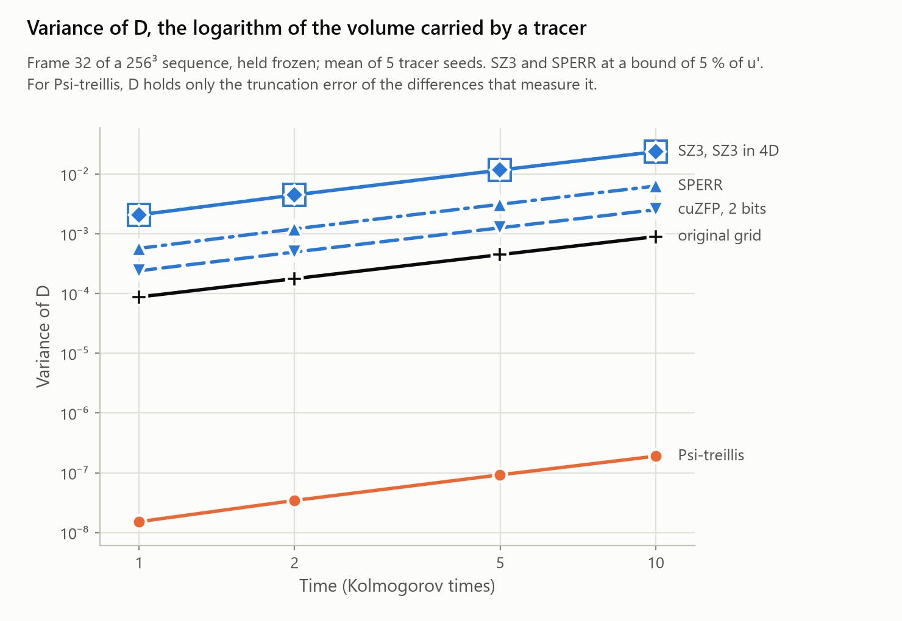
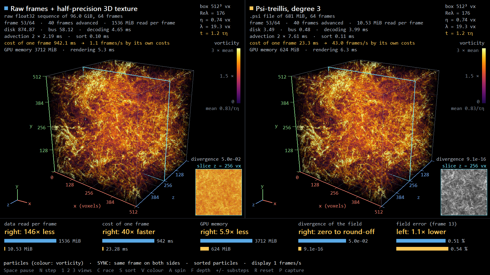

# Psi-treillis

[](https://github.com/Pluenet-Killian/Psi-treillis/actions/workflows/linux.yml)

**Divergence-free lossy compression of periodic turbulent velocity fields, decoded and sampled on the GPU.**

A turbulence simulation is a three-dimensional film: at every recorded instant it gives the velocity of the fluid at
every point of a grid. These films are huge: a single frame on a grid of 512 points per side is 1.5 GiB.

So they are compressed. General-purpose compressors treat the velocities as plain lists of numbers, and to use the
film, for instance to release particles in it and follow where the fluid carries them, one goes back through a grid of
velocities. This raises two problems.

- **The grid has to be rebuilt.** With the GPU compressor we tested, each frame is decompressed in full into the memory
  of the GPU before a single velocity can be read from it.
- **The fluid no longer obeys its law.** In an incompressible fluid, as much matter enters any small volume as leaves
  it. Read from a grid, the velocity no longer satisfies this exactly: small sources and sinks appear. Reading
  between the grid points already creates some, and compression adds more.

**Can these films be compressed so that the fluid still obeys its law at every point, and so that the GPU computes the
velocity without rebuilding the grid? And how much compression is lost in exchange?**

Psi-treillis stores, instead of the velocity, a vector potential whose curl is the velocity: a B-spline lattice with
integer coefficients, coded by temporal prediction and rANS. The curl of any field has zero divergence, so the law
holds at every point whatever the compressor does. The GPU decodes the potential and computes the velocity where it
needs it, without ever rebuilding the grid of velocities.

The article is in [paper/paper.pdf](paper/paper.pdf). This page gives its results in short; every number below is read
from the logs of [benchmarks/](benchmarks/) by `tools/paper_numbers.py`, never typed by hand.

## What the measurements say

<picture>
  <source media="(prefers-color-scheme: dark)" srcset="docs/figures/tracers_dark.png">
  
</picture>

Forced isotropic turbulence from the solver of this repository, on one machine (NVIDIA RTX 5090 Laptop GPU, Windows 11).

**What existing chains lose** (256³, bound of 5 % of the RMS velocity on the largest error, three realisations):

| Frame given back by | Divergence on the grid | Divergence as read by trilinear interpolation | Clustering of tracers |
|---|---|---|---|
| the original grid | 2.0 × 10⁻⁶ of the gradient | 4.1 to 4.6 % | 3.2 standard errors |
| SPERR | 5.8 to 6.0 % | 6.0 to 6.3 % | 107 |
| SZ3 | 10.4 to 11.1 % | 8.7 to 9.2 % | 672 |
| Psi-treillis, read directly | zero by construction, measured 9.4 × 10⁻¹⁶ | the same: no grid is read | 0.4 |

Tracers advected in one frozen frame should stay uniform; "clustering" is how far they depart from it after 10
Kolmogorov times, for a detection threshold of 5 standard errors.

**What Psi-treillis gives** (512³, degree 3, default settings):

| | |
|---|---|
| Compression ratio, at a relative RMS error of 0.64 % | 143 |
| Compression ratio with a bound of 5 %, 4 %, 3 % verified on every voxel | 136.6, 126.5, 100.1 |
| Against raw frames, when a sequence is replayed | 146 times less data read, 5.9 times less GPU memory |
| Decoding one frame; one RK4 step of 4 million sorted particles, the reader running alone | 3.74 ms; 4.01 ms |

**What it costs, and where it stops:**

- **It is not a general-purpose compressor and does not beat one.** At an equal bound, SZ3 in 4D compresses
  1.9 to 2.5 times more.
- **The bound needs resolved data.** Below 0.54 voxel per Kolmogorov scale, the 5 % bound cannot be held
  at the default lattice step. The public JHTDB isotropic dataset at 1024³ is below that threshold (0.46 to 0.47, computed from its documentation).
- **Its sampling is slower than that of a texture.** In the visual comparator, where two chains share the GPU, one RK4
  step of 4 million particles at 256³ costs
  6.5 ms through the lattice against 0.5 ms through cuZFP decoded to a texture, and a
  replayed frame 14.2 ms against 5.3 ms. At 512³ the frame is cheaper
  (21.7 ms against 59.3 ms) only because far less data is read from disk. The gain is
  in the data read and in the GPU memory.
- **Decoded to a grid, it has no advantage.** Its decoded grid, read by trilinear interpolation, has the divergence of
  the original grid. The benefit exists only when its field is read directly.
- **No public dataset was measured.** Access to JHTDB was obtained, but the transfers of the cutout broke repeatedly
  and no complete frame was retrieved. All the data come from our own solver.
- **One machine, one family of flows.** Periodic isotropic turbulence at 256³ and 512³; nothing is established
  elsewhere.

[docs/CLAIMS.md](docs/CLAIMS.md) lists 47 claims with their numerical criterion, the measurement and a
verdict: 28 hold, 10 do not, 9 are hypotheses not yet tested. The claims
refuted by our own measurements are on the same footing as the others.



*The visual comparator of the repository (`psi_view`): the same 512³ frames replayed by two chains, raw frames on the
left, Psi-treillis on the right. The band gives what the comparator measured during that run.*

## Installation

Requirements: an NVIDIA GPU, CUDA 13 with `nvcc`, CMake 3.24 or later, Ninja, a C++17 compiler. Developed and tested
on Windows with Visual Studio 2022; the build is also checked on Ubuntu 24.04 with GCC 13 at every commit, on a machine
without a GPU.

```powershell
.\tools\build.ps1                # Windows: library, psit and the example, in build\
```

With CMake directly, on Windows or Linux:

```bash
cmake -S . -B build -G Ninja -DCMAKE_BUILD_TYPE=Release
cmake --build build
cmake --install build --prefix /where/you/want
```

`-DPSIT_BUILD_TOOLS=ON` (or `.\tools\build.ps1 -Tools`) also builds the measurement instruments of `tools/`.

## Usage

**Python** (add `python/` to `PYTHONPATH`):

```python
import psitreillis as psi

info = psi.compress(frames, "flow.psi", dt=0.01, tolerance=0.05)   # frames: float32, shape (F, 3, n, n, n)
with psi.open("flow.psi") as f:
    u = f.decode(10)             # one frame on the grid: (3, n, n, n)
    v = f.sample(10, points)     # velocity at N arbitrary points, in grid-index units: (N, 3)
```

**Command line.** Field files are NumPy `.npy` arrays of shape `(F, 3, n, n, n)`, raw float32, or the `.seq` format
of the repository.

```powershell
psit compress flow.npy flow.psi --tolerance 0.05
psit info flow.psi
psit decompress flow.psi back.npy
psit sample flow.psi --frame 10 --at 12.5,40,7.25
```

**C and C++.** [include/psitreillis.h](include/psitreillis.h); with CMake, `find_package(psitreillis)` then
`psitreillis::psitreillis`.

Examples are in [examples/](examples/): a round trip in C and in Python, and particles followed through a compressed
file. The interface, its conventions and its limits are described in [docs/API.md](docs/API.md).

Input: a cubic periodic grid, `n` a power of two and at least 64, three float32 components, at least 5 frames. A field
that is not solenoidal loses its compressible part.

## Checking and replaying

```powershell
python tools\claims.py           # every claim against the logs kept in the repository (no GPU)
python tests\test_api.py         # public interface on a 64³ sequence (GPU)
python tests\test_codec.py       # codec chain: 50 cases, fingerprints of the files written (GPU)
```

Each folder of [benchmarks/](benchmarks/) holds one measurement: its script, its logs and a notice that says how to
replay it and what its caveats are. The sequences are not distributed (9 to 96 GiB each); the solver regenerates them
([benchmarks/data/](benchmarks/data/)).

## Repository

| | |
|---|---|
| `paper/` | The article: source, figures, bibliography, PDF |
| `include/`, `src/`, `python/`, `examples/` | The library: the codec and its public interface |
| `tests/` | Tests of the public interface and of the codec chain |
| `docs/` | Interface, file format, claims sheet |
| `benchmarks/` | One folder per measurement: script, logs, notice |
| `tools/` | Measurement instruments (turbulence solver, tracer experiment, visual comparator, two reference readers) and the scripts of the claims sheet, the figures and the numbers |
| `third_party/` | The compressors compared, as git submodules pinned at the revisions measured |

## Related software

Compared in this repository: [SZ3](https://github.com/szcompressor/SZ3), [SPERR](https://github.com/NCAR/SPERR),
[zfp and its CUDA backend](https://github.com/LLNL/zfp), [cuSZp](https://github.com/szcompressor/cuSZp).

## Citation and licence

To cite this work, see [CITATION.cff](CITATION.cff). The code is released under the Apache License 2.0
([LICENSE](LICENSE), [NOTICE](NOTICE)); the article in `paper/` under CC BY 4.0. Contributions are described in
[CONTRIBUTING.md](CONTRIBUTING.md).
